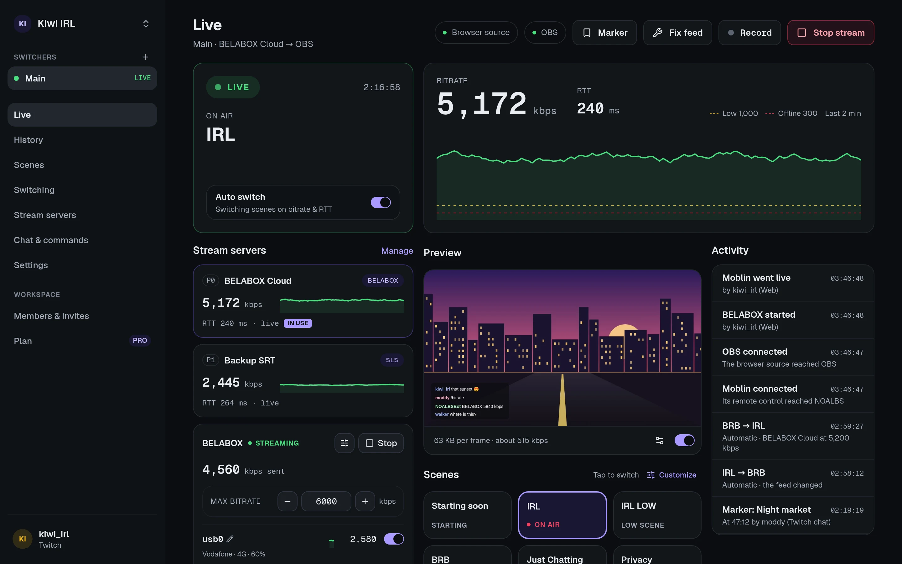

When you stream IRL, your encoder (a BELABOX, IRL Pro, Moblin, …) sends video over mobile
networks to a **stream server**, and OBS picks it up from there. When the connection gets bad,
viewers see a frozen or pixelated picture, or nothing at all.

NOALBS watches the stream server and switches OBS to the right scene for you:

| Scene | When |
| --- | --- |
| **LIVE** | The feed is healthy. |
| **LOW** | The bitrate dropped below your LOW trigger, or the latency (RTT) rose above it. A scene that hides the bad picture or says the connection is weak. |
| **BRB** | No usable feed. A "be right back" scene. |

When the feed recovers, it switches back.



## NOALBS and NOALBS Cloud

[NOALBS](https://github.com/NOALBS/nginx-obs-automatic-low-bitrate-switching) is a program
you run on your own PC next to OBS. NOALBS Cloud is the hosted version: the same switching
rules, but nothing to install or keep running, plus things a program on your PC can't do:

- a dashboard you can use from your phone or give to your moderators,
- stream history with charts, markers and every switch,
- chat commands on Twitch, Kick and YouTube without running a bot yourself,
- remote control of your BELABOX and Moblin.

## How it connects

```
OBS ── obs-websocket ── browser source ──► NOALBS Cloud ──► your stream server's stats
```

You add one **browser source** to OBS. It talks to OBS's built-in WebSocket server on your PC
and connects out to NOALBS Cloud, so there are no ports to open and nothing on your network
has to be reachable from the internet.

NOALBS Cloud reads your stream server's **stats URL** once a second, decides which scene
should be on air and tells OBS through the browser source. That only works while OBS is open
with the browser source active.

## Words used in these docs

- **Workspace**: your account's home. It holds your switchers and the people who can use them.
  You can be in several, for example your own and a streamer's you moderate for.
- **Switcher**: one OBS setup. It has its own browser source link, stream servers, scenes,
  triggers and chat settings. Most streamers have one.
- **Stream server**: where your encoder sends video. A switcher can have several, tried in order.
- **Triggers**: the bitrate (kbps) and latency (ms) at which NOALBS switches.

Ready? Go to the [quick start](/getting-started/quick-start/).
