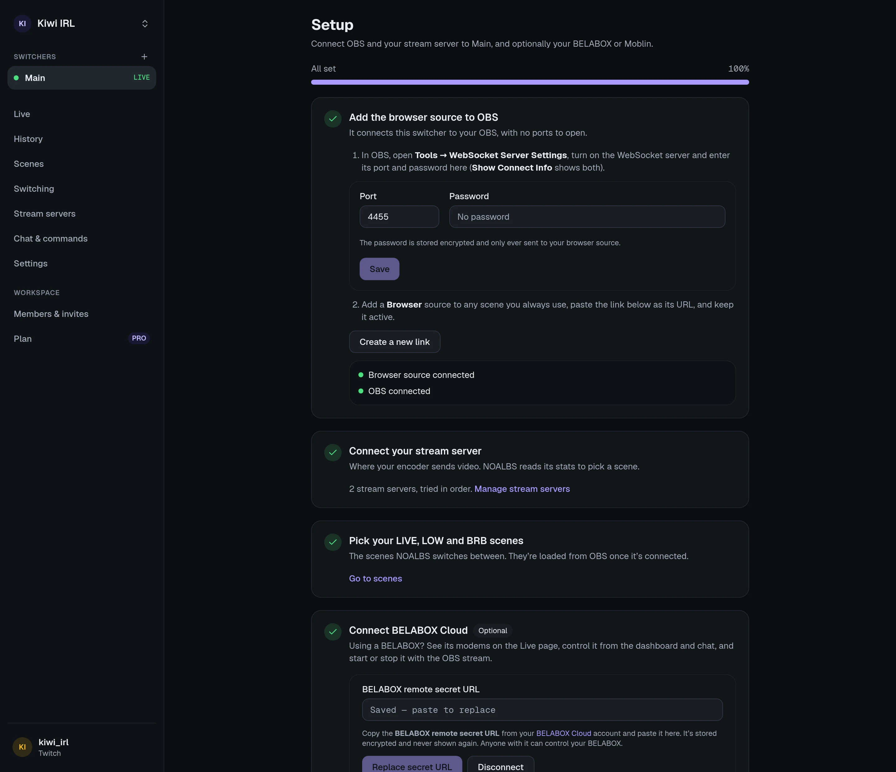

You need OBS 28 or newer (it has the WebSocket server built in), a stream server your encoder
sends to, and its stats URL.

## 1. Create a switcher

Sign in at [noalbs.com](https://noalbs.com) with Twitch, Kick or YouTube. The first time, you
create a **workspace** (a name and the URL it lives at) and then a **switcher**, which stands
for one OBS setup. You land on its **Setup** page, which walks you through the rest and shows
each step's status live.

## 2. Let NOALBS reach OBS

In OBS, open **Tools → WebSocket Server Settings** and turn on **Enable WebSocket server**.
**Show Connect Info** shows the port and password: enter them on the Setup page.

The password is stored encrypted and only sent to your browser source.

## 3. Add the browser source

Press **Create browser-source link** and copy the link.

:::caution
The link contains a secret and is shown only once. Anyone with it can control your OBS, so
don't show it on stream. If it gets out, create a new one: the old one stops working.
:::

In OBS, add a **Browser** source to a scene you always have open (any scene works, it doesn't
have to be visible), paste the link as its **URL** and keep the source enabled. Leave
**Shutdown source when not visible** off.

The Setup page shows **Browser source connected**, then OBS connected. If it stays at
"waiting for OBS", check the WebSocket port and password.

## 4. Add your stream server

Press **Add a stream server**, pick its kind (BELABOX, MediaMTX, SLS, …) and paste its **stats
URL**. Some kinds also need a stream key or publisher name. **Test connection** checks that
NOALBS Cloud can read it.

[Stream servers](/guides/stream-servers/) explains the options, and the
[list of kinds](/reference/stream-server-kinds/) what each one needs.

## 5. Pick your scenes

On the **Scenes** page, choose which OBS scene is your **LIVE**, **LOW** and **BRB** scene.
The list comes from OBS, so it's empty until OBS is connected.

That's it. With the default settings NOALBS:

- switches to LOW at **800 kbps** or below, or at **2500 ms** RTT or above,
- switches to BRB when there's no feed,
- waits for **5 bad checks** in a row (one per second) before leaving LIVE,
- goes back to LIVE as soon as the feed is back,
- only switches **while you're streaming**: it leaves OBS alone otherwise.

Change these under **Settings → Switching**; see [Switching](/guides/switching/).

## Next

- [Connect your chat](/guides/chat-bot/) for `!bitrate`, `!switch` and the other commands.
- [Connect your BELABOX](/guides/belabox/) or [Moblin](/guides/moblin/), if you use one.
- Invite your moderators: [Workspaces and members](/guides/workspaces/).
