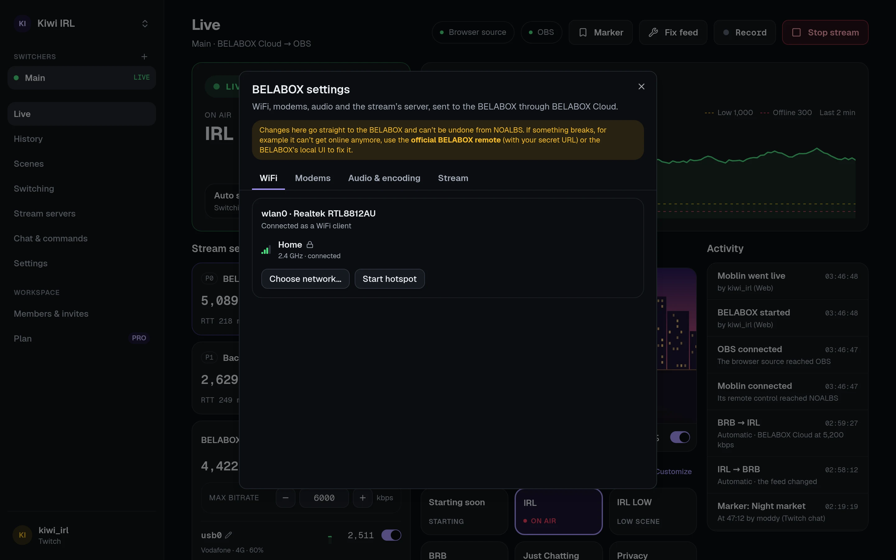

import { Image } from "astro:assets";
import card from "../../../assets/screenshots/belabox-card.webp";

If your BELABOX is on [BELABOX Cloud](https://cloud.belabox.net), NOALBS Cloud can show its
modems and sensors, change its bitrate, and start or stop it, from the dashboard and from chat.
This is optional and separate from switching: to switch on your BELABOX feed, add BELABOX Cloud's
**stats URL** as a [stream server](/guides/stream-servers/) too.

:::note
NOALBS Cloud works with BELABOX Cloud but isn't affiliated with or endorsed by BELABOX.
:::

## Connecting

1. In your BELABOX Cloud account, copy the **BELABOX remote secret URL**
   (`https://remote.belabox.net/?key=…`).
2. On the switcher's **Settings** page, under **BELABOX Cloud**, paste it and press **Connect
   BELABOX**.

The key is stored encrypted and never shown again. Anyone with it can control your BELABOX, so
keep it off stream. The connection runs while OBS is open with the browser source; the Setup page
and the BELABOX card show its status.

## On the Live page

<Image src={card} alt="The BELABOX card: streaming at 4,510 kbps, the max bitrate, three interfaces with their bitrate, a modem's network and signal, a notification and the sensors." width={352} />

The **BELABOX** card shows whether it's online and streaming, the total bitrate and each network
interface's share with a small chart, modem network and signal, its sensors (temperature,
voltage, …) and its notifications.

People who can control the switcher also get:

- **Start** and **Stop**.
- **Max bitrate**: −/+ 250 kbps, or type a value. While the BELABOX isn't streaming it's kept for
  its next start.
- A switch per **interface** to turn it off or on. The last one can't be turned off.
- **Names** for interfaces (`usb0` → "Phone 1"), so you and chat know which modem is which. A
  name follows the modem when it moves to another USB port.

## Settings

The settings button on the card opens BELABOX's own settings, with tabs:

- **WiFi**: the network each adapter is on; choose another network (scan, connect, join with a
  password, forget), and the hotspot.
- **Modems**: network type, operator (after a scan, which takes the modem offline for a moment),
  APN and roaming.
- **Audio & encoding** and **Stream**: pipeline, audio source and codec, delay, SRT latency,
  relay server or your own address.

Stream and encoding settings **can't be saved on the BELABOX itself** from outside: NOALBS keeps
them and uses them the next time it starts the BELABOX. They're locked while it streams.

:::caution
A wrong WiFi or modem setting can cut your BELABOX off, and NOALBS can't undo it once the BELABOX
is unreachable. Keep the official BELABOX Cloud remote or the BELABOX's own web UI at hand as a
way back.
:::

Joining or forgetting networks and changing the hotspot or modems needs permission to manage
the switcher, since they can cut the BELABOX off or involve passwords.

## Start and stop with OBS

On **Settings → BELABOX Cloud**:

- **Start BELABOX with the OBS stream**: when the OBS stream starts (from OBS, the dashboard or
  `!start`), BELABOX starts with its saved settings.
- **Stop BELABOX with the OBS stream**: when the OBS stream stops (from OBS, the dashboard,
  `!stop`, a raid or a timeout), BELABOX stops too. Leave it off to keep it running.

## Chat commands

The belabot commands: `!bbstart`, `!bbstop`, `!bbb [kbps]`, `!bbt <interface>`, `!bbs` (alias
`!bbm`) and `!bbsensor`. See [chat commands](/reference/chat-commands/#belabox). They stay
silent on switchers without BELABOX connected.
