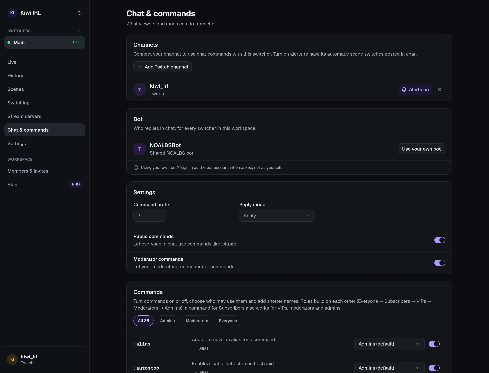

Connect your channel and NOALBS's bot answers [commands](/reference/chat-commands/) like
`!bitrate` and `!switch` in your chat. You don't run anything yourself.

## Connecting your channel

On a switcher's **Chat & commands** page, under **Channels**, press connect for your platform
and **sign in with the channel's own account**. That lets the NOALBS bot into its chat.

- One channel can drive several switchers, even in different workspaces: a command runs on all
  of them, and replies start with `[switcher name]` so you can tell them apart.
- **On YouTube**, commands work while you're live: the bot finds your live chat once OBS is
  streaming.
- If you remove NOALBS from your connected apps on the platform, the channel shows **Needs
  reconnecting**; connect it again to fix it.

## Who replies

By default the shared **NOALBS bot** account replies. Plans with **Own chat bot** let a workspace
connect its own bot account under **Bot** on the Chat page: sign in **as the bot account**, not
as yourself. It speaks for every switcher in the workspace.

## Who may use what

Each command has a minimum role, and you can change it or turn the command off on the Chat page.
From high to low:

| Role | Who |
| --- | --- |
| **Admin** | The broadcaster, and members of your workspace (by the platform account they signed in with). |
| **Moderator** | Moderators (including Twitch's lead moderator). |
| **VIP** | VIPs. |
| **Subscriber** | Subscribers (including founders). |
| **Public** | Everyone. |

- **Public commands** off (`!public off`): public commands need a moderator.
- **Mod commands** off (`!mod off`): the moderator badge doesn't count, so moderators get the
  role of their other badges (VIP, subscriber), or Public.
- Below moderator, each command has a 5-second cooldown.
- **Ignored chatters** (on the Chat page, or `!noalbs ignore <name>`) can't run anything. Other
  bots connected to NOALBS are always ignored.

## Prefix, aliases and replies

- The prefix is `!` by default; change it on the Chat page or with `!noalbs prefix <new>`
  (1 to 3 characters).
- **Aliases** are extra names for a command. New switchers come with `!b` (bitrate), `!f` (fix),
  `!ss` (switch) and `!bbm` (bbs). Add more on the Chat page or with `!alias <alias> <command>`.
- Replies answer the command's message as a reply. Turn **threaded replies** off on the Chat page
  for plain messages.

## What the bot says on its own

- **Automatic switches**, with **Chat notification** on (Settings → Switching): "Switched to
  LOW · BELABOX Cloud at 640 kbps". Turn it off per channel on the Chat page.
- **Raids**, with **Stop stream after a raid** and **Announce raids**: that the stream stopped,
  with a link to the raided channel (Twitch and Kick).
- **Stop when offline** and **Stop on the Ending scene**: that the stream was stopped. These are
  always said in every connected channel.
