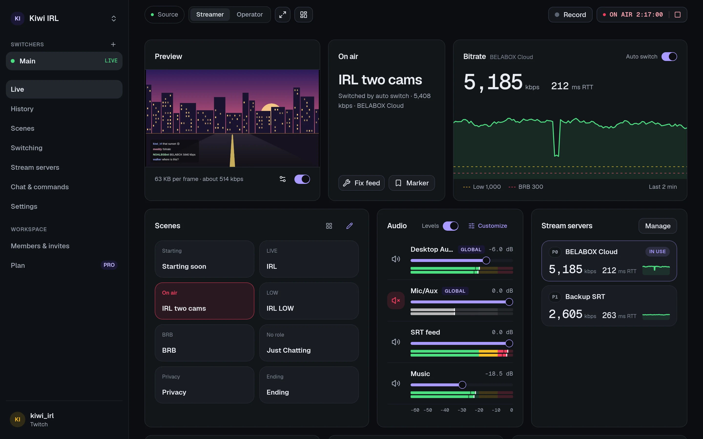
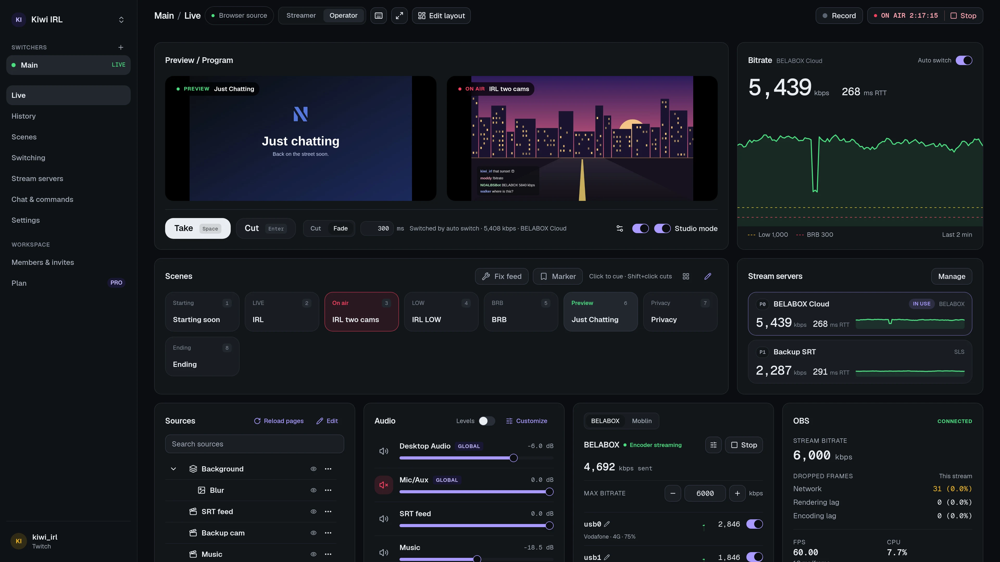
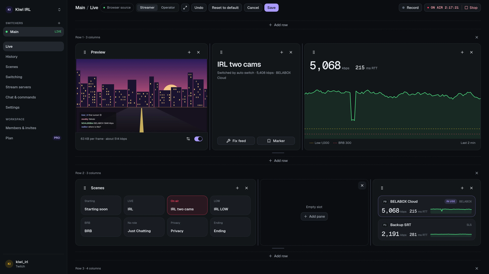
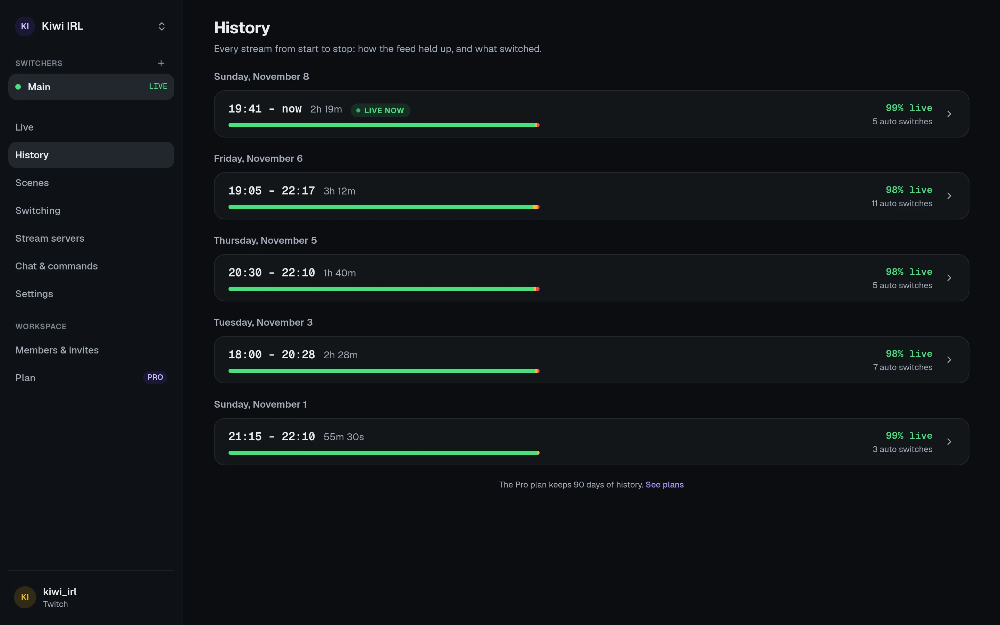
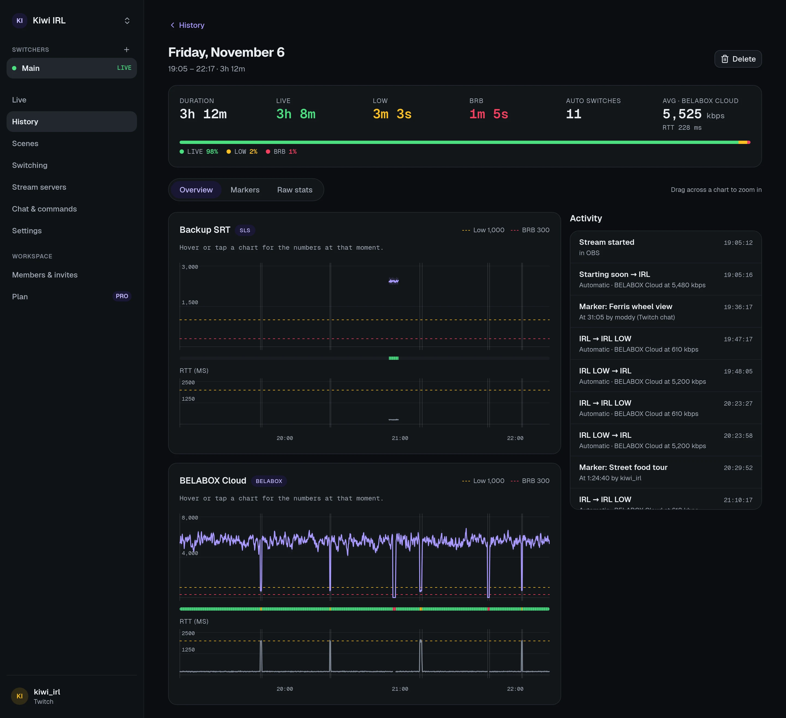

import { Image } from "astro:assets";
import livePhone from "../../../assets/screenshots/live-phone.webp";
import obsStats from "../../../assets/screenshots/obs-stats.webp";

The dashboard works on a phone as well as a computer, so you or a moderator can keep an eye on
the stream and fix things from anywhere. On a phone, the tabs at the bottom are **Live**,
**History** and **Settings**.

<Image src={livePhone} alt="The Live page on a phone, with sticky stream status, Preview and Bitrate panes, and the Live, History and Settings tabs." width={300} />

## Live

What's happening now, updated every second. The page is made of panes, so you can keep the
controls you need together. It scrolls normally; panes aren't squeezed into the window's height.

### Streamer and Operator

**Streamer** is the default. Tap a scene to switch straight to it, watch the feed and audio, and
use **Auto switch** in **Bitrate** to pause or resume automatic switching.

On a computer, choose **Operator** in the top bar for **Preview / Program**, scene shortcuts and
transition controls. This is an opt-in view, not a different account role or permission. Your
choice is remembered in this browser. Phones keep their single-column Streamer view.

With **Studio mode** on:

1. Click a scene to cue it in **PREVIEW**. **PROGRAM** is what OBS is showing now; cueing doesn't
   change it. The preview picture follows the switcher's off-air preview permissions, so you
   may see the scene's name instead of its picture.
2. Pick one of OBS's transitions and set **Transition duration** in milliseconds. The duration
   field is disabled for transitions with a fixed duration.
3. Select **Take** to put the cued scene on Program using that transition, or **Cut** to switch
   immediately. Shift-click a scene to cut straight to it without cueing it first.

With **Studio mode** off, clicking a scene switches directly, as in Streamer mode.

**Keyboard shortcuts** opens **Operator shortcuts**. These work on a computer in Operator mode,
outside text fields, dialogs and **Edit layout**:

| Key | Action |
| --- | --- |
| `1`–`9` | Cue one of the first nine listed scenes, or switch directly with **Studio mode** off. The numbers don't change when you search. |
| `Shift` + `1`–`9` | Cut directly to that scene. |
| `Space` | **Take** the cued scene. |
| `Enter` | **Cut** to the cued scene. |
| `/` | Focus **Search scenes**, when the search field is shown. |
| `?` | Open the shortcuts dialog. |
| `F` | Toggle **Immersive**. |
| `Esc` | Exit **Immersive**, unless a dialog or layout edit needs closing first. |

No shortcut starts or stops streaming or recording.

### The top bar and status

The top bar stays visible while you scroll, on a computer or phone. On a computer, the on-air
timer is inside **Stop stream** and the recording timer is inside **Record** / **Stop recording**.
On a phone, the status stays at the top and the stream and recording controls are in **Actions**.

**Start stream**, **Stop stream** and **Stop recording** open confirmation dialogs. Starting a
recording with **Record** doesn't ask first. Stopping a recording saves the file so far; recording
again starts a new file.

**On air** shows the output state and current scene. After a stream stops, its scene is marked
**Active**, not **On air**. If OBS or its browser-source connection is lost, **OBS disconnected**
means the output state is unknown, not that the stream has stopped. Scene and preview state is
dimmed and marked as last known. **No feed** in **Bitrate** means bitrate is unavailable; it isn't
a healthy reading of 0 kbps.

**Immersive** hides the application sidebar and page header, leaving the Live controls and panes.
It isn't browser fullscreen. Select **Exit immersive** to return; the sticky status bar stays
visible in either view.

### Preview

**Preview** shows stills of what OBS is showing, refreshed at the rate you choose. It's on by
default on computers and off on phones. Use **Show the OBS preview** to toggle it, and
**Preview settings** to change **Rate**, **Size** and **Quality**. Every frame costs a bit of your
upload, so keep the rate low while streaming over mobile data.

The title row shows who else is watching the preview. Off-air pictures follow the switcher's
preview permissions; turning the preview on doesn't bypass them.

### Scenes and Sources

**Scenes** has grid and list views. Tap a scene to switch in Streamer mode, or cue it in Operator's
**Studio mode**. With more than eight scenes, **Search scenes** appears and the list scrolls
inside the pane. A compact strip keeps the current and cued scenes visible above the list.
Long names are shortened to fit; hover for the full name.

**Sources** shows the sources of the current scene as one indented tree, including nested scenes
and groups. Use a group's chevron to collapse or expand its children. With more than eight
sources, **Search sources** filters the list and keeps matching sources' parent groups visible.
Long lists scroll inside the pane, on phones too.

**Scenes** has an **Edit scenes** pencil button; **Sources** has **Edit**. Each opens one Edit view
where you choose which items this browser lists. Hiding an item here doesn't delete or hide it in
OBS, and other browsers keep their own choices. Newly added OBS scenes appear automatically;
the current scene stays listed.
Select **Done** when you're finished.

With the appropriate OBS permissions, the same Edit view also manages scenes or sources in OBS:
add, rename or remove scenes, add sources, or drag sources to change their order. In Sources,
**Listed** only controls this browser's list; reordering changes OBS. Outside Edit, tapping a
source or its eye shows or hides it in OBS, which does affect the output.

The source row menu offers these actions, depending on your permissions and the source's kind:

- **Edit…**: change the source's settings.
- **Position…**: change its placement.
- **Reload page**: refresh a browser source.
- **Duplicate…**: make a copy.
- **Remove from …**: remove it from its scene or group, after confirmation.

### Audio and health panes

- **Audio**: OBS's mixer, with mute and volume. **Levels** shows live audio meters; they're on by
  default in Streamer mode. Your explicit on/off choice is remembered in this browser. Meters
  use some upload and pause while the browser tab is hidden.
- **Stream servers**: a tile per server, led by bitrate and **ms RTT**, with a 2-minute chart whose
  colour shows its LIVE, LOW or BRB state. **No feed** means the server has no bitrate. The **P0**, **P1**, … badge is its priority; lower numbers come
  first. **In use** marks the server the switcher is using.
- **OBS**: OBS's own bitrate, dropped frames by cause (network, rendering lag, encoding lag),
  FPS, CPU, memory and free disk. Chat: `!serverinfo`.

  <Image src={obsStats} alt="The OBS pane with stream bitrate, dropped frames, FPS, CPU, memory and free disk." width={360} />

- **Activity**: every switch, start, stop, setting change and command, and who did it.
- **BELABOX** and **Moblin**, if you [connected](/guides/belabox/) [them](/guides/moblin/): device
  controls and health. **Encoder streaming** and **Moblin streaming** describe those devices,
  not whether OBS is on air.

If a [Connect](/guides/connect/) computer is linked and you have permission, **OBS** also shows
**Start OBS** or **Stop OBS**, and **Restart OBS**. Stopping or restarting asks you to confirm and
can interrupt a running stream. **Programs** lists programs added through Connect, with
**Start** / **Stop** controls. OBS control and program control have separate permissions.

### Edit layout

Layouts belong to the current switcher and mode, in this browser only. Editing Streamer's layout
doesn't change Operator's, another switcher's, or anyone else's. A phone has its own pane order,
separate from the desktop rows.

#### On a computer

1. Select **Edit layout** in the top bar. You're editing a draft; normal pane controls and
   Operator shortcuts are disabled until you leave the editor.
2. Select **Add row** between rows or at the bottom, then choose **1 column**, **2 columns**,
   **3 columns** or **4 columns**. The new row starts with empty slots.
3. Select **Add pane** in an empty slot and choose a pane. Only panes not already placed and
   available for this switcher are offered; for example, device panes need that device set up.
4. To make room beside an existing pane, use **Add beside** in its title row. This adds an empty
   slot to its right; fill it with **Add pane**. A row can have at most four slots.
5. Drag a pane by its title row. Drop in the centre of another pane to swap them, on its left or
   right edge to insert beside it (if the row has room), in an empty slot to fill it, or on a
   between-rows line to make a new one-pane row. Follow the drop indicator: nothing moves until
   you drop. A move removes the old slot; a swap keeps both slots.
6. Drag the divider between two panes to change just those two widths. It stops at the panes'
   minimum widths. Double-click the divider to equalize the pair, or focus it and use Left/Right
   to resize and Enter to equalize. Drag the handle under a row to set its minimum height;
   double-click it to return to automatic height. Content can still make a row taller, so it
   isn't clipped. Growing a row also gives long Scenes and Sources lists more scrolling space.
7. Use **Hide** in a pane's title row to remove it from the layout, leaving an empty slot. Use the
   empty slot's remove button to remove that slot, or the row's remove button to remove the whole
   row. These don't delete anything in OBS. Rows with no slots disappear; empty slots and
   empty-only rows aren't shown outside the editor.
8. **Undo** steps back through your draft changes. **Reset to default** replaces the draft with
   the default layout. Select **Save** to keep it, or **Cancel** to discard it; Escape also cancels
   the draft when no menu or dialog is open. Reset isn't saved until you select **Save**.

There is one saved desktop layout for all window widths. If a row can't fit its panes' minimum
widths, trailing panes wrap onto continuation rows; widening the window puts them back. In a
very narrow desktop content area, panes stack in their saved order. Wrapping never rewrites the
layout, so a pane hidden in a wide window stays hidden after narrowing or reloading.

#### On a phone

1. Select **Edit layout** in the top bar.
2. Use a pane's up/down buttons to change its order, or **Hide** to remove it from the phone list.
3. Use **Add pane** to put an available pane at the end, or **Reset** to restore the default phone
   order.
4. Select **Done** to leave the editor. Phone changes are saved as you make them, without the
   desktop draft's Save/Cancel step, and don't change desktop rows.

### Fix feed

Reconnects the network media sources (SRT, RTMP, RIST, …) playing on the scene on air,
including those in nested scenes and groups. Use it when OBS shows a frozen picture although the
stream server has the feed. Chat: `!fix`.

### Markers

**Marker** flags this moment on the running stream, with an optional note, for example to
find a clip later. Markers are listed on the stream's History page (Copy or Download as
`H:MM:SS note` lines). Chat: `!marker [note]`.

## History

Every stream from OBS start to stop, grouped by day, kept for as long as your plan's history
retention. A stream's page shows:

- how long it spent in LIVE, LOW and BRB,
- a chart per stream server: average bitrate, the min–max band, your triggers, RTT and where it
  switched,
- the activity during the stream, and its markers.

Drag across a chart to zoom in. **Raw stats** (for people who manage the switcher) charts any
number your stream server reported, which helps when something looks odd.

## Safe to show on stream

Streamers often have the dashboard on screen. Anything that holds a key, like stats URLs or the
browser-source link, is hidden until you reveal it, and Copy copies it without showing it.
