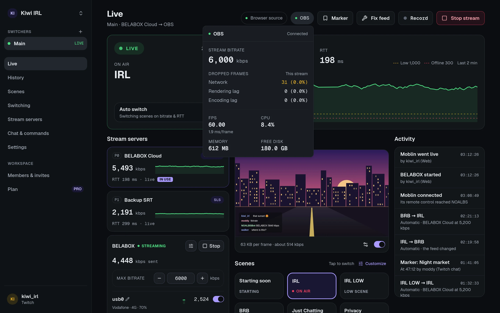
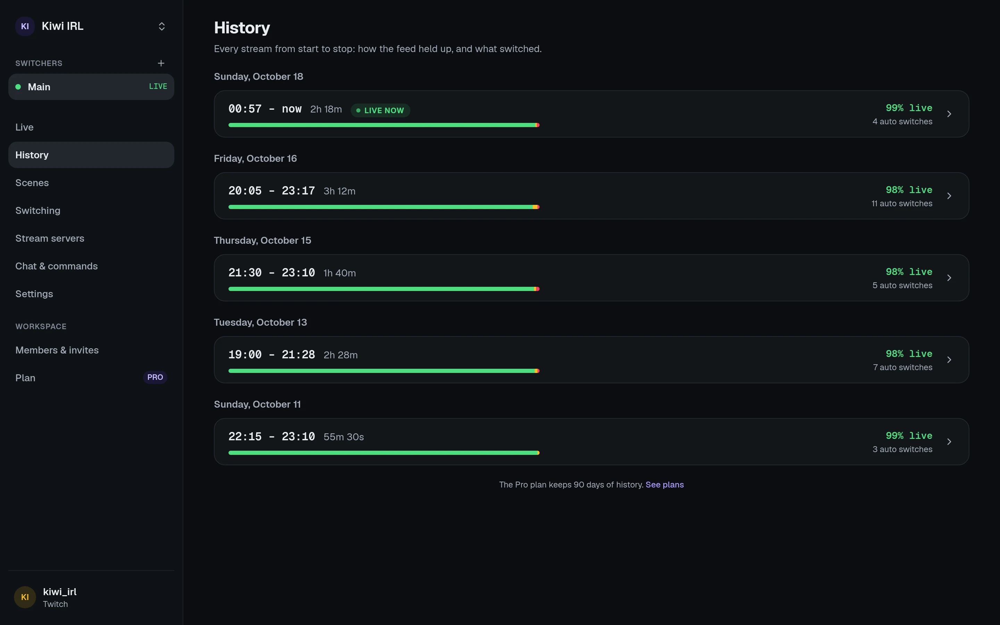
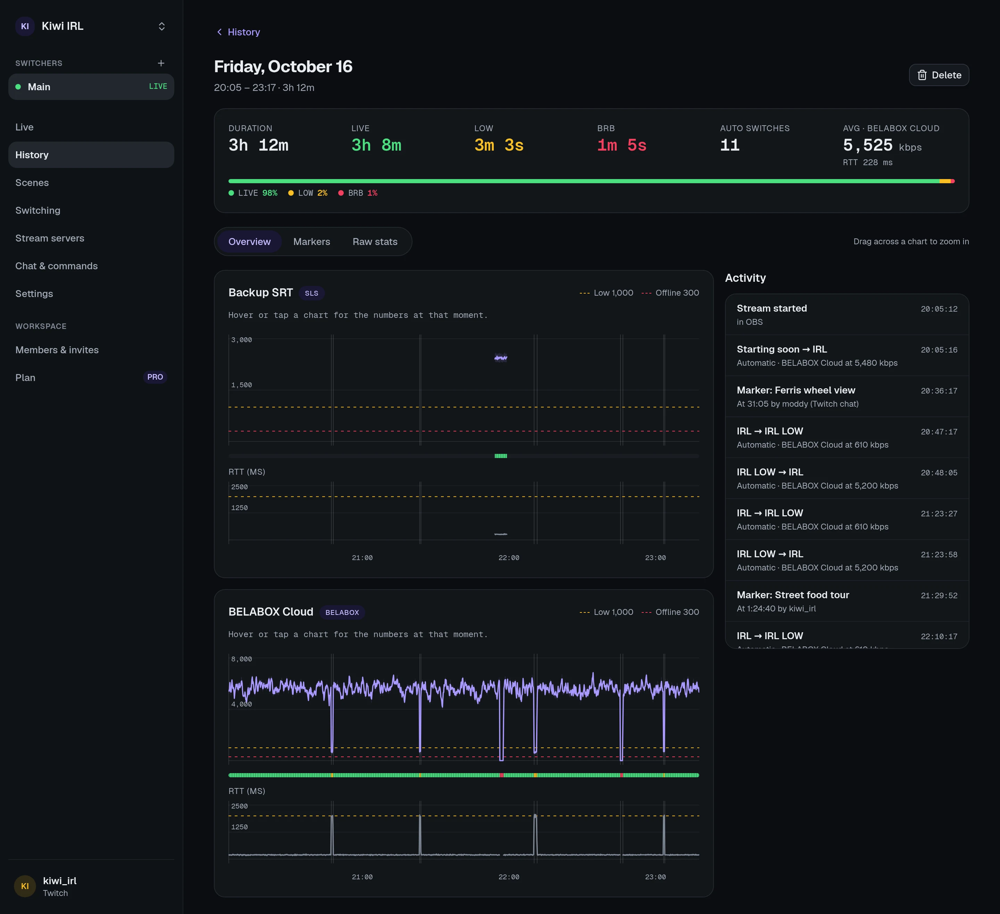

import { Image } from "astro:assets";
import livePhone from "../../../assets/screenshots/live-phone.webp";

The dashboard works on a phone as well as a computer, so you or a moderator can keep an eye on
the stream and fix things from anywhere. On a phone, the tabs at the bottom are **Live**,
**History** and **Settings**.

<Image src={livePhone} alt="The Live page on a phone: LIVE at 5,348 kbps, with Stop stream, Record, Auto switch, Fix feed and Marker, and the tabs Live, History and Settings." width={300} />

## Live

What's happening now, updated every second.

- **Stream servers**: each server's bitrate and RTT with a 2-minute chart, and which state
  (LIVE, LOW, BRB) it's in. The one in use is marked.
- **Start stream** / stop, **Record**, **Fix feed** and **Marker** (see below).
- **Auto switch**: turn automatic switching off and on, for example while you do something by
  hand.
- **Preview**: a still of what's on air, refreshed at the rate you choose. It's on by default on
  computers and off on phones. Every frame costs a bit of your upload, so keep the rate low
  while streaming over mobile data.
- **Scenes**: tap one to switch to it. **Customize** hides scenes you never use (just for you;
  new OBS scenes show up on their own).
- **Sources**: show or hide the sources of the scene on air, including those in nested scenes
  and groups. Customize hides them here too.
- **Audio**: OBS's mixer with mute and volume. **Levels** shows live meters; it's off until
  you turn it on, since the levels also cost your upload.
- **OBS** (the chip at the top): OBS's own stats: dropped frames by cause, FPS, CPU, memory,
  free disk and the bitrate it sends out.
- **Activity**: every switch, start, stop, setting change and command, and who did it.
- **BELABOX** and **Moblin** cards, if you [connected](/guides/belabox/) [them](/guides/moblin/).

### OBS's stats

The **OBS** chip at the top opens OBS's own numbers, read every 2 seconds while it's open: the
bitrate OBS sends out, dropped frames by cause (network, rendering lag, encoding lag) for this
stream, FPS, CPU, memory and free disk. Chat: `!serverinfo`.

### Fix feed

Reconnects the network media sources (SRT, RTMP, RIST, …) playing on the scene on air,
including those in nested scenes and groups. Use it when OBS shows a frozen picture although the
stream server has the feed. Chat: `!fix`.

### Markers

**Marker** flags this moment on the running stream, with an optional note, for example to
find a clip later. Markers are listed on the stream's History page (Copy or Download as
`H:MM:SS note` lines). Chat: `!marker [note]`.

## History

Every stream from OBS start to stop, grouped by day, kept for as long as your plan's history
retention. A stream's page shows:

- how long it spent in LIVE, LOW and BRB,
- a chart per stream server: average bitrate, the min–max band, your triggers, RTT and where it
  switched,
- the activity during the stream, and its markers.

Drag across a chart to zoom in. **Raw stats** (for people who manage the switcher) charts any
number your stream server reported, which helps when something looks odd.

## Safe to show on stream

Streamers often have the dashboard on screen. Anything that holds a key, like stats URLs or the
browser-source link, is hidden until you reveal it, and Copy copies it without showing it.
