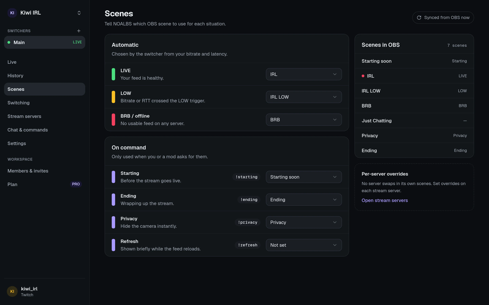

On a switcher's **Scenes** page you tell NOALBS which of your OBS scenes to use for each
situation. The list comes from OBS, so connect OBS first.

## Automatic

Chosen by the switcher from your bitrate and latency.

| Role | Used when |
| --- | --- |
| **LIVE** | Your feed is healthy. |
| **LOW** | Bitrate or RTT crossed the LOW trigger. |
| **BRB / offline** | No usable feed on any server. |

[Stream servers](/guides/stream-servers/#scene-overrides) can override these three while
they're in use.

## On command

Only used when you or a moderator asks for them, from the dashboard or chat.

| Role | What for | Chat |
| --- | --- | --- |
| **Starting** | Before the stream goes live. Can be shown automatically on go-live (see [Switching](/guides/switching/#start-end-and-raids)). | `!starting` |
| **Ending** | Wrapping up the stream. Can stop the stream after a while (the [ending timeout](/guides/switching/#stopping-automatically)). | `!ending` |
| **Privacy** | Hide the camera instantly. | `!privacy` |
| **Refresh** | Shown for a few seconds while the feed reloads. | `!refresh` |

## Which scenes NOALBS switches away from

NOALBS only switches away from scenes it knows: LIVE, LOW, BRB (and the servers' overrides),
and Starting when **Then switch to LIVE** is on. When anything else is on air, say your Privacy
scene or a "just chatting" scene you picked by hand, it leaves OBS alone until you switch back
to one of those.

That's how you take over: switch to another scene and NOALBS won't fight you.
