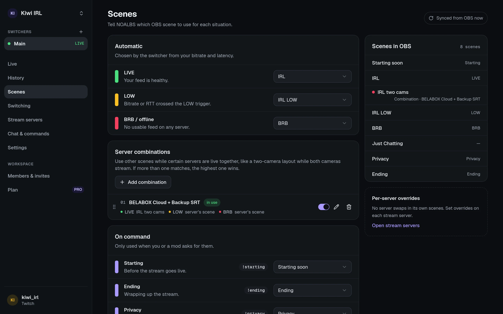

import { Image } from "astro:assets";
import combination from "../../../assets/screenshots/scene-combination.webp";

On a switcher's **Scenes** page you tell NOALBS which of your OBS scenes to use for each
situation. The list comes from OBS, so connect OBS first.

## Automatic

Chosen by the switcher from your bitrate and latency.

| Role | Used when |
| --- | --- |
| **LIVE** | Your feed is healthy. |
| **LOW** | Bitrate or RTT crossed the LOW trigger. |
| **BRB / offline** | No usable feed on any server. |

[Stream servers](/guides/stream-servers/#scene-overrides) can override these three while
they're in use, and [server combinations](#server-combinations) while several servers are live.

## Server combinations

When you stream through more than one server at once, a combination gives a set of them its own
LIVE, LOW and BRB scenes. For example: a two-camera layout while your BELABOX and a backup camera
are both live, and your normal scenes again as soon as one of them drops.

<Image src={combination} alt="Editing a server combination: BELABOX Cloud and Backup SRT picked, with IRL two cams as its LIVE scene and LOW and BRB left on Server's scene." width={512} />

Add one with **Add combination**: pick two or more servers, then the scenes to use.

- **When:** a combination is used while **all** of its servers have a feed, even if other servers
  have one too. A [disabled](/guides/stream-servers/#several-servers-backups-and-priority) server
  never has a feed, so a combination with one in it isn't used; its row says so.
- **Order:** when more than one combination fits, the highest in the list wins. Drag to reorder.
  A combination that can never win, because one above it always fits first, says so.
- **LIVE or LOW** is still decided by the server in use (the first in your server list with a
  feed), as always. The combination only changes which scenes are shown.
- **Server's scene:** a scene you leave on this uses what you'd get without the combination: the
  server's [override](/guides/stream-servers/#scene-overrides), or else the switcher's scene.
- **BRB:** when every server drops, the BRB scene of the combination last in use is shown.
- **No flip-flopping:** moving onto or off a combination waits the
  [checks before switching](/guides/switching/#checks-before-switching), like a feed change, so a
  second uplink that keeps dropping in and out doesn't flip the layout back and forth.
  [Instant recovery](/guides/switching/#switching) from BRB still switches at once.

The combination whose scenes are on air shows **in use**. Each one has a switch to turn it off
without deleting it, and removing a stream server also removes the combinations it's in. A
switcher can have up to 20.

## On command

Only used when you or a moderator asks for them, from the dashboard or chat.

| Role | What for | Chat |
| --- | --- | --- |
| **Starting** | Before the stream goes live. Can be shown automatically on go-live (see [Switching](/guides/switching/#start-end-and-raids)). | `!starting` |
| **Ending** | Wrapping up the stream. Can stop the stream after a while (the [ending timeout](/guides/switching/#stopping-automatically)). | `!ending` |
| **Privacy** | Hide the camera instantly. | `!privacy` |
| **Refresh** | Shown for a few seconds while the feed reloads. | `!refresh` |

## Which scenes NOALBS switches away from

NOALBS only switches away from scenes it knows: LIVE, LOW, BRB (and the servers' overrides and
the combinations' scenes), and Starting when **Then switch to LIVE** is on. When anything else is
on air, say your Privacy scene or a "just chatting" scene you picked by hand, it leaves OBS alone
until you switch back to one of those.

That's how you take over: switch to another scene and NOALBS won't fight you.
