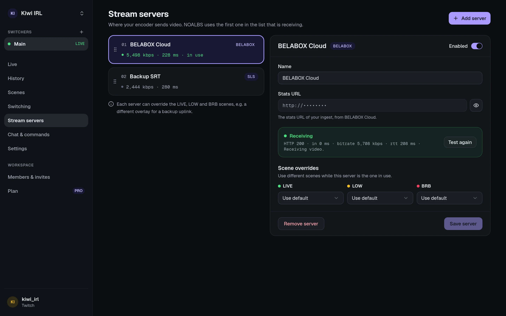

A **stream server** is where your encoder sends video, and where OBS picks it up: BELABOX
Cloud, your own MediaMTX or SRT Live Server, a hosted ingest, … NOALBS doesn't receive your
video. It reads the server's **stats URL** once a second to see the bitrate and latency of your
feed.

Manage them on a switcher's **Stream servers** page.

## Adding one

Press **Add a stream server** and fill in:

- **Kind**: the server software. Each kind reports its stats differently; see
  [stream server kinds](/reference/stream-server-kinds/) for what each needs.
- **Stats URL**: the address of its stats page or API.
- **Kind-specific settings**, for servers that carry several streams: which publisher,
  application or stream key is yours. Some kinds also take a username and password or an API key.
  Passwords and keys are stored encrypted and never shown again.

**Test connection** fetches the stats URL once from NOALBS Cloud and says what it found. If it
works there, the switcher can read it too.

:::note[The stats URL must be reachable from the internet]
NOALBS Cloud reads stats from its own servers, not from your PC. A server on your home network
(`192.168.…`, `10.…`, `localhost`) can't be reached and is refused. Use its public address, or a
hosted ingest. Redirects aren't followed either: use the final URL.
:::

Stats URLs often contain a key, so the dashboard shows only the start of them until you reveal
them (handy when the dashboard is on stream), and only people who can manage the switcher see
them at all.

## Several servers: backups and priority

You can add more than one server, for example a backup uplink or a second ingest. They're
tried **in the order of the list** (drag to reorder): NOALBS uses the first server that is
receiving video, and its bitrate and latency decide the scene. When it loses the feed, the
next one that has a feed takes over.

A server you **disable** isn't read and doesn't count.

All servers are read every second, live or not, so the Live page always shows their numbers.

## Scene overrides

Each server can have its own LIVE, LOW and BRB scenes, used instead of the switcher's while
that server is the one in use. For example: a different overlay that says "backup connection".

When there's no feed at all, the BRB scene of the server that was last in use is shown.

## How many

Your plan sets how many stream servers a switcher can have. After a downgrade, servers over the
limit keep working; you just can't add more.
