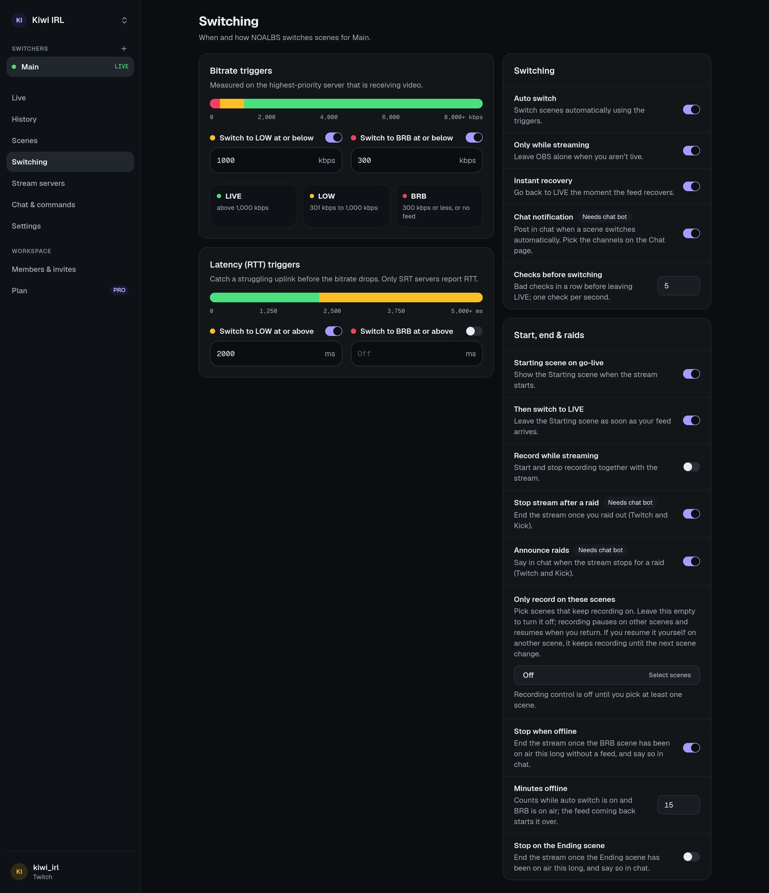

A switcher's **Settings → Switching** page decides when and how NOALBS switches scenes. The
rules are the same as NOALBS's on your PC.

## Triggers

### Bitrate

| Setting | Default | |
| --- | --- | --- |
| **Switch to LOW at or below** | 800 kbps | |
| **Switch to BRB at or below** | off | Off means BRB only when there's no feed at all. |

The BRB bitrate must be lower than the LOW one. The bar on the page shows which range leads to
which scene.

### Latency (RTT)

Round-trip time catches a struggling uplink before the bitrate drops. Only SRT servers report it.

| Setting | Default |
| --- | --- |
| **Switch to LOW at or above** | 2500 ms |
| **Switch to BRB at or above** | off |

The BRB RTT must be higher than the LOW one. Leave a trigger empty to turn it off. Moderators
can change all four from chat: `!trigger`, `!otrigger`, `!rtrigger`, `!ortrigger`.

Both are measured on the **first server in your list that is receiving video** (see
[stream servers](/guides/stream-servers/#several-servers-backups-and-priority)). The worse of the
two decides.

## Switching

| Setting | Default | |
| --- | --- | --- |
| **Auto switch** | on | Switch scenes automatically using the triggers. Off: NOALBS only shows numbers and runs commands. |
| **Only while streaming** | on | Leave OBS alone when you aren't live. Turn it off to test switching without going live. |
| **Instant recovery** | on | When the feed comes back after BRB, switch at once instead of waiting for the checks below. |
| **Chat notification** | on | Post in chat when a scene switches automatically. Needs the [chat bot](/guides/chat-bot/). |
| **Checks before switching** | 5 | See below. |

### Checks before switching

NOALBS checks once a second. When the feed changes, say from LIVE to LOW, the new state must
hold for this many **more** checks in a row before NOALBS switches. With 5, a dip has to last
about 6 seconds. That keeps a short hiccup from flashing the LOW scene on stream.

It applies in both directions: going back from LOW to LIVE also waits. The exceptions:

- **Instant recovery** (above): from BRB to a feed at once.
- Servers that push their stats instead of being read (IRLHosting WebSocket) drop to LOW or BRB
  at once, and always wait before going back to LIVE.

Set it to 0 to switch on the first bad check.

### When a feed connects without a bitrate yet

Right after your encoder connects, some servers report the stream with 0 kbps for a moment.
NOALBS doesn't treat that as LOW: it keeps (or goes back to) the LIVE or LOW scene you were on
and waits for a real number.

## Start, end and raids

| Setting | Default | |
| --- | --- | --- |
| **Starting scene on go-live** | off | Show the Starting scene when the stream starts. |
| **Then switch to LIVE** | off | Leave the Starting scene as soon as your feed arrives. |
| **Record while streaming** | off | Start and stop recording together with the stream. |
| **Stop stream after a raid** | off | End the stream once you raid out (Twitch and Kick). Needs the chat bot. |
| **Announce raids** | off | Say in chat when the stream stops for a raid, with a link to the raided channel. |

### Stopping automatically

- **Stop when offline**: end the stream once the BRB scene has been on air this long (in
  minutes) without a feed. Handy when the encoder died and you can't reach OBS.
- **Stop on the Ending scene**: end the stream once the Ending scene has been on air this long.
  This works even with Auto switch off, since you put that scene there yourself.

Both say in chat that they stopped the stream, if a chat is connected. Leave them empty for off.
If BELABOX or Moblin are set to stop with the OBS stream, they stop too.

### Only record on these scenes

Pick scenes that keep recording on. While you record, the recording **pauses** on any other
scene and resumes when you come back to one of these. Leave it empty to turn it off.

If you resume the recording yourself on another scene, it keeps recording until the next
scene change. Some recording formats can't be paused; the activity feed says so when OBS refuses.

## Paused switchers

A switcher over its plan's limit (after a downgrade) is **paused**: it stays connected and
shows its numbers but doesn't switch or take commands. Upgrade, or delete another switcher, and
it resumes on its own.
