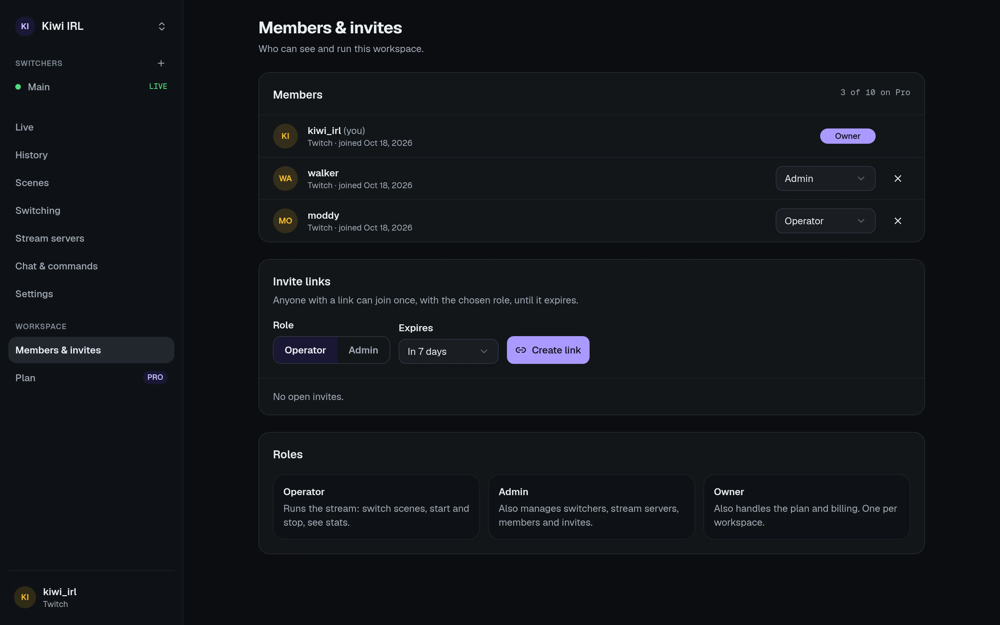

A **workspace** holds your switchers, your plan and the people who can use them. You can be in
several: your own, and those of streamers you help. Switch between them in the workspace menu;
**All workspaces** lists every one with what it's doing now.

## Roles

| Role | Can |
| --- | --- |
| **Operator** | See everything and control the stream: switch scenes, start and stop, fix the feed, BELABOX and Moblin controls. A good fit for moderators. |
| **Admin** | All that, plus change switcher settings (servers, scenes, triggers, chat), see stats URLs and raw stats, and manage members. |
| **Owner** | All that, plus billing, transferring ownership and deleting the workspace. There's one owner. |

Only the owner hands out or takes away **Admin**; admins can add and remove operators. Anyone
but the owner can leave.

Members' linked Twitch, Kick or YouTube accounts count as **Admin** for [chat
commands](/guides/chat-bot/#who-may-use-what).

## Inviting people

Under **Settings → Members**, create an invite link with a role. Anyone with the link can join
once, with that role, until it expires. The link is shown only when you create it. Your plan sets
how many members a workspace can have.

## Ownership

The owner can hand the workspace to an admin (**Settings → General → Transfer ownership**);
they become an admin themselves. Billing details are removed from the workspace, so the new owner
adds their own payment method before the next renewal. Deleting the workspace deletes its
switchers, history and settings at once and ends a paid subscription.

## NOALBS support access

NOALBS staff can't see your workspace unless you let them. When you ask for help, an owner or
admin can grant access under **Settings → General → NOALBS support access**:

- **View**: see your switchers, settings and live data.
- **Control**: also control and change them.

Access lasts for the hours you choose (up to a week), and you can end it at any time. Every page
support opens is in the **log** there.

Support never gets your secrets: the browser-source link, the Moblin password, raw stats, your
BELABOX's network details, or stored passwords and keys. They do see stats URLs, since a mistyped
one is the most common problem.

In an emergency (say your switcher misbehaves on stream and you can't be reached) staff can open
**emergency access** for one hour, with a written reason. Owners and admins see a banner about it
and the reason in the log.

## Managed workspaces

Some streaming services and agencies run NOALBS Cloud for their customers. If your workspace is
**managed by** an organization, it says so under the workspace name: the organization pays for it
and its team can see and change everything in it, and you join as an admin.
